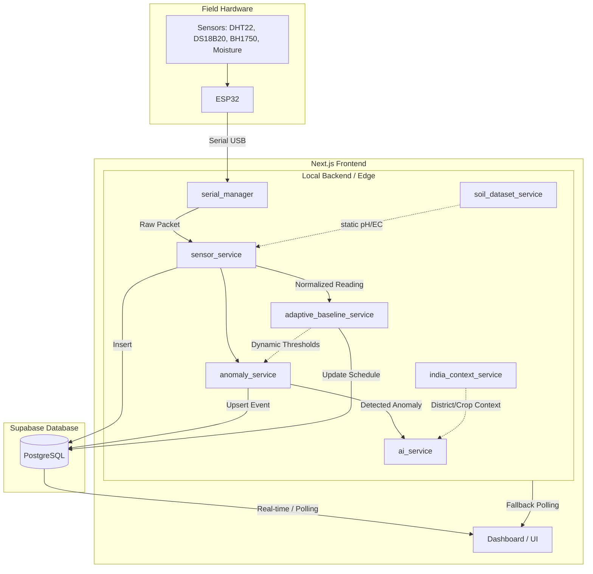

# MARUDAM Architecture

## 1. Project Overview

**What MARUDAM is:**  
MARUDAM is an AI-powered agricultural monitoring system designed to track physical sensor data (temperature, moisture, humidity, lux) and enrich it with static dataset references (pH, EC), contextualized by weather and geographical location (India).

**Project purpose:**  
To provide farmers with localized, real-time insights into crop health and irrigation needs, augmented by Google Gemini AI for contextual recommendations.

**Main problem being solved:**  
Translating raw, volatile sensor data into actionable, localized agricultural intelligence. Standard sensor thresholds fail across different microclimates and crop stages.

**Target users:**  
Farmers and agricultural managers in India (specifically with localization for Indian languages and districts).

## 2. Overall Architecture

MARUDAM employs a hybrid local-cloud architecture:

1. **Field Layer (ESP32):** Reads physical sensors via I2C and analog pins. Transmits data via USB Serial.
2. **Local Edge (FastAPI):** Ingests serial data, normalizes it, applies dataset fallbacks (pH/EC), runs adaptive baselines, detects anomalies, and pushes enriched events to the cloud.
3. **Cloud Layer (Supabase):** Acts as the central persistence layer, storing historical sensor readings, baseline schedules, anomalies, events, and farm configurations. Uses Row Level Security (RLS).
4. **Presentation Layer (Next.js):** The frontend dashboard that subscribes to Supabase real-time updates and also polls the local backend API as a fallback.

## 3. Technology Stack

- **Frontend:** Next.js 14, React, Tailwind CSS, Supabase SSR Client, Framer Motion, Recharts.
- **Backend:** Python 3, FastAPI, Uvicorn, Pyserial.
- **Database:** PostgreSQL (managed by Supabase).
- **ESP32:** C++, Arduino framework.
- **Sensors:** DHT22 (Temp/Hum), DS18B20 (Soil Temp), BH1750 (Lux), ADS1115 (Analog-to-Digital), Capacitive Soil Moisture Sensor v1.2.
- **AI:** Google Gemini (via `google-generativeai` Python SDK).
- **External Services:** Open-Meteo (Weather API).

## 4. Complete Data Flow Diagram

## 5. Deviations from Intended Architecture

1. **Dataset Enrichment vs Physical Sensors:** While the system claims to monitor pH and EC, the physical ESP32 implementation *does not* include pH or EC sensors. Instead, the `sensor_service.py` intercepts the packet and injects static median pH and EC values derived from `soil_dataset.csv` based on the configured crop.
2. **Local API Polling vs Cloud WebSockets:** The frontend dashboard (`page.tsx`) attempts to poll `http://127.0.0.1:8000/api/sensors/latest/{deviceId}` directly. If deployed on Vercel, this fails due to mixed-content/localhost isolation, forcing the frontend to fall back entirely on the Supabase client.
3. **ESP32 JSON vs Human-Readable:** The production ESP32 code is designed to output JSON. However, a temporary test sketch was found outputting human-readable text. `serial_manager.py` was patched to maintain a stateful `_test_buffer` to parse this text line-by-line and reconstruct the expected JSON format.
